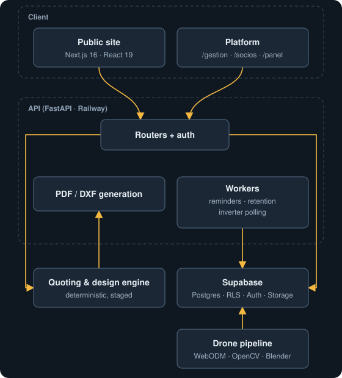
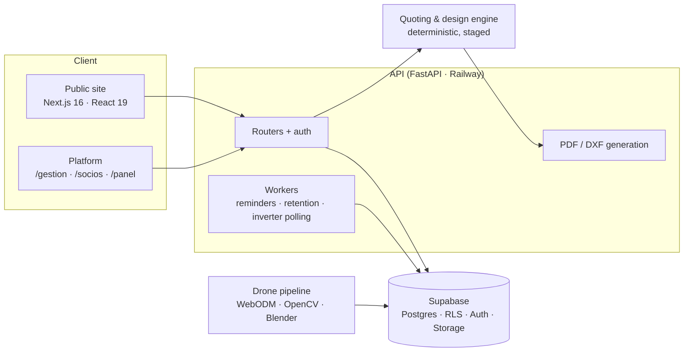

# Everna Platform

**The business system of [Everna](https://everna.lat/en), a solar-installation company in Costa Rica: quoting, engineering design, drone-based site measurement and client portal, built end to end by one engineer.**

> A **case study**: the source code is private. This page covers what the system does, how it is built and how it is verified.
> Everna has three co-founding engineers; I designed and built the software.

---

## What it is

Everna designs and installs photovoltaic systems for mid-size commercial and industrial customers. Sizing, tariff analysis, electrical design, drawings and pricing usually live in spreadsheets and CAD files; this platform puts them behind one system:

- a **quoting and design engine** that turns demand and roof geometry into a sized system, a price, a client PDF, DXF drawings and a calculation memo;
- a **public website**, an **internal management panel** and a **client portal** for monitoring;
- a **drone and photogrammetry pipeline** that measures roofs from photos;
- an **agent layer** (custom agents, reusable skills, a Slack-connected agent) used to operate and extend the system.

## Numbers (counted from the repository)

| | |
|---|---|
| Code | ~175k lines of Python, TypeScript and SQL |
| Automated tests | 5,000+ test functions (engine, API, drone tooling) plus Playwright end-to-end |
| API | 24 routers, ~174 route handlers |
| Database | 36 tables, 101 migrations, row-level security with three roles |
| History | 1,400+ commits between May and November 2026 |

## Architecture

Diagram source (Mermaid)

| Layer | Stack |
|---|---|
| Web | Next.js 16 (App Router), React 19, TypeScript, Tailwind v4, react-three-fiber for 3D site views |
| API | Python 3.12, FastAPI, Pydantic v2, WeasyPrint, ezdxf, shapely |
| Data | Supabase (Postgres, Auth, private Storage with signed URLs), audited migrations |
| Delivery | Docker, Vercel (web), Railway (API, infrastructure as code), GitHub |
| Geoprocessing | WebODM, OpenCV, scipy, shapely, Blender (headless) |

## The engine

The core of the system is a **deterministic, staged calculation engine**: demand → sizing → conductors → conduit → losses → battery → tariff and billing → pricing → surplus. Every result is traceable and reproducible, so the numbers are auditable.

- Sizing follows **NEC 2020** and local tariff structures; yield uses **PVGIS** data.
- Outputs: client PDF, DXF drawing sheets, calculation memo and partner report.
- Verified by **golden cases** (frozen catalog and solar data), **Python/JavaScript parity tests** for the quick calculator and **monotonicity tests** (more load never produces a smaller system).

## Drone and photogrammetry

Mission planning for a consumer drone, photo processing with WebODM, georeferencing, roof and neighbour extraction with OpenCV and shapely, mesh simplification with Blender, and publication of orthophoto, height map and 3D model into the design workflow.

## Engineering practices

- **Test-gated delivery:** changes reach `main` only through pull requests with a green `verify` run and code-owner review.
- **Tiered verification:** `verify` picks what to run (unit tests, Docker checks, Playwright, smoke tests) from the files that changed.
- **Security:** row-level security with three roles, private storage with short-lived signed URLs, secret scanning (gitleaks), least-privilege tokens, a pre-push hook that blocks direct pushes to `main`.
- **Data safety:** transactional migrations with a prior backup and a ledger; a disposable Postgres to test RLS.
- **Documentation as code:** a plan with status and hand-off per feature, and a checker that keeps docs consistent with the code.

## AI-native engineering capabilities

Built with an agent-first workflow. The capabilities behind it:

- **Agent orchestration:** specialist agents (quoting, finance, orchestration) in parallel isolated worktrees, one pull request per change, written plans that carry status between sessions.
- **Context engineering:** versioned repository rules, a sourced domain knowledge base and a single source of truth for catalogs, so agents act on facts.
- **Skills and tool design:** packaged procedures for drone route planning, photogrammetry, quote reporting and data integration.
- **Guardrails:** permission rules, protected branches, secret scanning, least-privilege tokens and audit logs; a Slack-connected agent with identity-based access (full environment for the engineer, read-only for everyone else).
- **Verification of generated work:** golden cases, parity and monotonicity tests, end-to-end and visual regression; tests make the final call.
- **Architecture judgment:** knowing where deterministic, auditable logic is the right tool and where agents add leverage.

---

[everna.lat](https://everna.lat/en) · [Andrey Quesada](https://github.com/andreyques41) · © Everna. All rights reserved. No source code is published in this repository.
